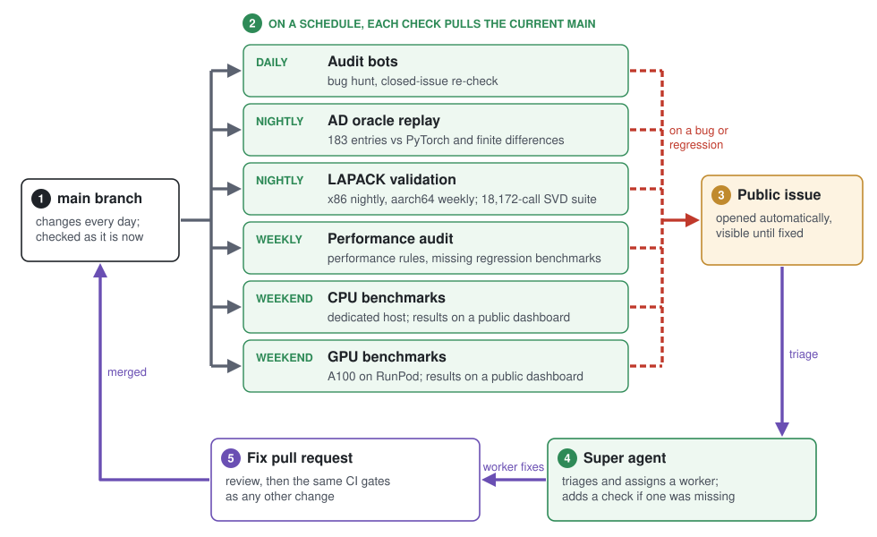
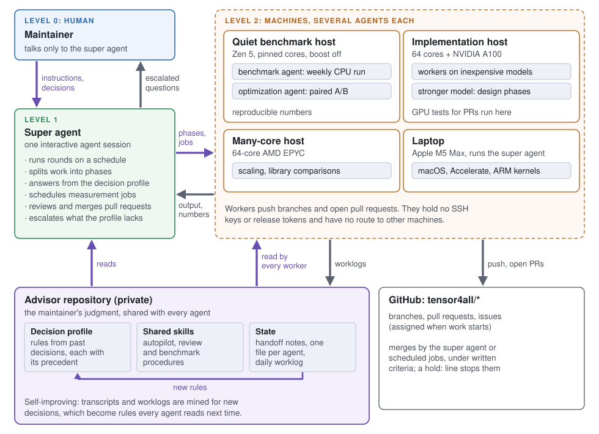
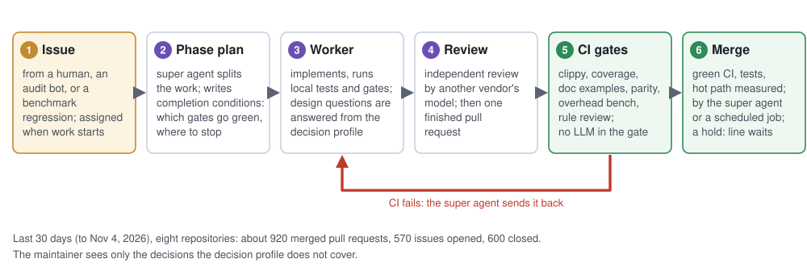

# 誰も逐行で読まないコードをどう検証しているか

*tensor4all の Rust スタックの大半は AI エージェントが書いており，我々はそれを逐行でレビューしていません．代わりに何をしているかを説明し，どこまで信頼してよいかを利用者自身が判断できるようにするための記事です．*

by **品岡 寛**（埼玉大学），tensor4all チームを代表して

*🌐 [English](https://tensor4all.org/blog/how-we-check-agent-written-code/) · [日本語](https://tensor4all.org/blog/how-we-check-agent-written-code-ja/)*

## なぜこの記事を書くのか

[tensor4all](https://tensor4all.org) のスタック（[tenferro-rs](https://github.com/tensor4all/tenferro-rs)，[tensor4all-rs](https://github.com/tensor4all/tensor4all-rs)，およびその下のカーネル群）は大きく，そのほぼすべてをコーディングエージェントが書いています．利用者からは当然，「作者が全行を読んでいないのに，なぜ結果を信じられるのか」という疑問が出ます．

我々の答えはこうです．数値計算コードの信頼性は，逐行レビューだけで担保できたことはありません．レビュアーは見落とし，コードが大きくなるほど見落としは増えます．我々にできるのは，信頼を機械へ移すことです．毎日コードを検査し，結果を公開し，壊れたら大きな音を立てる仕組みです．これがなければ，エージェントの力を使い切れません．エージェントは人間がレビューできる速さを超えてコードを書くので，検査を自動にしない限り，その速さは無駄になります．

[tenferro-rs の紹介記事](https://tensor4all.org/blog/introducing-tenferro-rs-ja/)ではこの考え方を短く述べました．本記事では，実際に動いている仕組みを層ごとに説明します．規模の目安として，2026年11月4日時点でスタックは9リポジトリ（tenferro-rs，tensor4all-rs，strided-rs，tcontract-rs，tlinalg-rs，cpueinsum-rs，hataori-rs，tidu-rs，computegraph-rs，テスト込み）で空行を除き約93万行の Rust コードからなり，これに faer のフォークへ追加した約3万6千行が加わります．

図は英語版と共通です．

## 原則：検査を走らせ続ける

一度だけ走った検査は，ほとんど何も証明しません．コードは毎日変わり，依存も動き，先月速かったベンチマークは今日について何も語りません．そこで我々の検査で最も重要な性質は，**定期的に，現在の main に対して走り，結果を公開すること**です．監査とオラクルの再生は毎日，CPU と GPU のベンチマークは毎週末に走ります．

参照データは独立したリポジトリに置いています．勾配データは [tensor-ad-oracles](https://github.com/tensor4all/tensor-ad-oracles) に，性能比較は [tenferro-benchmark](https://github.com/tensor4all/tenferro-benchmark)，[tensor4all-benchmark](https://github.com/tensor4all/tensor4all-benchmark)，およびライブラリごとのベンチマークにあります．こうしておくと，参照データの変更はそれ自体が独立した変更として見え，ライブラリのどの版に対しても参照データを再実行できます．

下の図はこのループを示しています．図中の super agent と監査ボットは後の節で説明します．

## 自動微分の正しさ

誤った勾配は最も気づきにくいバグです．プログラムは動き，損失は下がり，結果だけが微妙にずれます．我々は勾配を，自分たちの推論ではなくデータベースと照合しています．

- **tensor-ad-oracles** には，要素ごとの演算，縮約，そして約40の線形代数ファミリ（SVD，固有値分解，QR，LU，Cholesky，求解，擬似逆行列，行列式，ノルムなど）の参照ケースがあります．tenferro-rs が再生している版は183件（174演算）です．
- 参照値は版を固定した PyTorch で生成し，**独立した有限差分と照合**しています．各規則の導出ノートは，PyTorch 自身の autograd の式と照合しています．保存しているのは数値と出所だけで，PyTorch や JAX のソースは一切コピーしていません．
- tenferro-rs はテストでこのデータベースを再生し，さらに**毎晩，現在の main に対して全件を再生**しています（コミットのない日は省略）．
- 各演算が微分に対応しているかどうかは manifest に宣言され，テストがそれと実態の一致を確かめます．

また，AD 規則のファイルは行カバレッジではなく数値検査で保証すると決めています．カバレッジの数字を上げるためだけのテストを書くことは，そこでは明示的に禁止しています．

## 線形代数カーネルの正しさ

- **パリティ検査．** [tlinalg](https://github.com/tensor4all/tlinalg-rs) には，同じインタフェースを持つネイティブ実装と LAPACK 実装があります．専用の parity crate が，要素型とバッチ形状を変えながら両者に同じ入力を与え，結果を突き合わせます．
- **LAPACK による検証．** faer のフォークである [t4a-faer](https://github.com/tensor4all/faer) は，LAPACK のテスト入力に対する数値検証を，x86 では毎晩，aarch64 では毎週走らせています．たとえば SVD では，リファレンス LAPACK 自身の SVD テストドライバのテスト群を移植し，既知・密集・極端なスペクトルを含む 18,172 回の呼び出し（f32，f64，c32，c64 それぞれ 4,543 回）からなるスイートにしています．これは，まだ壊れている箇所を見つける手段でもあります．失敗が出れば issue が開かれ，直るまで見える状態に残ります．
- **上流のバグの記録．** t4a-faer と上流 faer の差分はすべて，公開の台帳 `PATCHSET.md` に載っています．状態，検証方法（「修正前は失敗し，修正後は通る」），そして上流のバグについては，用意できたものには上流向けの報告が付いています．

### 実例：SVD スイートが捕まえたパニック

10月下旬，SVD スイートが f32 と c32 でパニックを報告しました．`svd` が「buffer is not large enough」で止まったのです．作業領域は，同じ引数で呼んだ `svd_scratch` が見積もったものでした．最小の再現例は，分割統治法で計算する 8×8 のランク1行列で，`V` だけを求める場合でした．

修正（[tensor4all/faer#73](https://github.com/tensor4all/faer/issues/73)）では，バッファに余裕を足すのではなく，作業領域の見積もりそのものを直しました．各マージ段階で同時に生きている一時領域を数えるようにしています．修正前に失敗し修正後に通る回帰テストを加え，再帰の境界付近の 4,800 回の呼び出しが4つの型すべてで通り，その後 18,172 回のスイート全体も呼び出しの失敗なく完了しました．同じ実行で，f32 の直交性に関する別の問題も見つかり，[#75](https://github.com/tensor4all/faer/issues/75) として別に追跡しました．この作業領域のバグは上流の faer 0.24.4 にもあるため，再現プログラム付きの上流向け報告を用意しました．

## 性能

HPC では，性能の退行は誤った答えに近いほど高くつき，しかも何も失敗しないので見落としやすいものです．我々はこれも同じように扱います．

- **CI のオーバーヘッドゲート．** strided-rs，tcontract-rs，tlinalg-rs，cpueinsum-rs は，すべてのプルリクエストで小さなオーバーヘッドベンチマークを走らせます．テンソルネットワークのスイープは同じ小さな演算を数千回呼ぶので，呼び出しごとのオーバーヘッドが効きます．
- **外部との比較．** tenferro は PyTorch や JAX と，カーネル群は OpenBLAS，MKL，Apple Accelerate，TBLIS，HPTT，上流の faer と比較しています．
- **専用機での週次計測．** 毎週末，固定した CPU ホストで，共有の版固定に従ったライブラリを使ってベンチマークを走らせます．実行するのはエージェントですが，意図的に**何も決める権限を持たせていません**．マージも，版の変更も，再試行もできず，異常があれば止まり，どのエージェントとモデルが実行したかを記録します．結果は履歴付きの公開ダッシュボードに出ます（たとえば [faer](https://tensor4all.org/faer-benchmark/) や [tenferro](https://tensor4all.org/tenferro-benchmark/)）．
- **GPU での週次計測．** tenferro の GPU ベンチマークは，毎週末 RunPod で借りた NVIDIA A100 上で走り，CPU の結果と同じ経路で公開されます．
- **複数種類のハードウェア．** 性能の最適化は一台のマシンに合わせて行いません．週次計測用のホストに加え，64コアの AMD EPYC サーバ，A100 を積んだ64コアのサーバ，Apple M5 Max のノート PC を使い，あるマイクロアーキテクチャでは速くなるが別のものでは遅くなる変更を見つけます．最適化と計測のジョブをこれらのマシンに割り振り，数値を回収するのは後述の super agent です．
- **対になった比較．** 速くなったと主張する変更は，同じマシンで基準と比較し，変更していない参照行をマシン状態の対照に使います．そうした計測のない主張は受け入れません．

## 規約と，規約の検査

異なる機関の複数の共同研究者が，同じコードにそれぞれ自分のエージェントを走らせています．共通の規約がなければ，各グループのエージェントが同じ失敗を別々に繰り返し，同じ問いに別々の答えを出すことになります．

そこで，リポジトリをまたいで成り立つ規約は，公開の一か所 [tensor4all-agent-rules](https://github.com/tensor4all/tensor4all-agent-rules) にまとめ，エージェントと人間の貢献者の両方が従います．内容は，リポジトリ構成と依存境界，リリースの安全性，性能のチェックリストと性能主張の計測方法，ドキュメントとテストの方針（たとえばドキュメントのコード例は一つも飛ばさない），第三者の仕事のクレジット，Rust と Julia の数値・性能の規則などです．各リポジトリの `AGENTS.md` は短く保ってここを指し，その上に tenferro-rs の `REPOSITORY_RULES.md` や `PERFORMANCE_TIPS.md` のようなリポジトリ固有の規約が載ります．

最初の規則は「実装が文書に優先する」です．文書とコードが食い違えば，欠陥は文書の側です．規約で防げたはずの失敗をエージェントがすると，その規約を足し，全共同研究者のエージェントがそれを取り込みます．

ただし規約は文章にすぎないので，機械で強制できるものは CI が強制します．

- フォーマットと，警告をエラーとして扱う clippy（すべてのエラーとパニックの文書化を含む）．
- ファイルごとのカバレッジのしきい値．
- ドキュメント中のすべてのコード例がコンパイルされ，実行されること．
- crate の依存境界を越えていないかなどのアーキテクチャ検査．
- 最小対応 Rust 版，macOS と Linux，必要なところでは GPU ランナー．
- プルリクエストをリポジトリ規約に照らす決定的なレビュー．このゲートに LLM は関与しません．

## ワーカーと保守者の間に立つ監督エージェント

コードを書くエージェントに，リポジトリを任せきりにはしていません．日々の実装の大半は，安価なモデルで動くワーカーエージェントが担います．その上に監督役のエージェント，「super agent」（監督エージェント）がいて，注意深い保守者が担う役割を果たします．

- 大きな仕事をフェーズに分け，完了条件（どのゲートを緑にするか，どこで止まるか）を明示してワーカーに渡し，結果を読みます．
- ワーカーが設計上の質問をすると，super agent は保守者の**判断プロファイル**から答えます．過去の判断から抽出した規則で，それぞれ根拠となった先例に紐づいています．プロファイルが扱わない質問は人間に回します．
- このプロファイルは非公開の advisor リポジトリにあり，**共通スキル**（フェーズを自走させる autopilot の手順，レビューやベンチマークの手順）と，共有の **state**（引き継ぎメモ，エージェントごとのファイル，日次の作業記録）も一緒に置かれています．super agent とすべてのワーカーがこれを読むので，保守者が直接話さないエージェントにも保守者の判断が届きます．しかも**自己改善を続けます**．対話記録と作業記録から新しい判断を掘り出し，先例付きの規則にして加えるので，すべてのエージェントが次の仕事からそれを使います．クラッシュや文脈の上限で super agent のセッションが途切れても，新しいセッションが state から引き継げます．
- 完成した仕事は，書いたモデルとは**別のベンダー**のモデルが独立にレビューします．書き手とレビュアーが同じ盲点を共有しないためです．
- ワーカーはブランチを push してプルリクエストを開けますが，SSH 鍵やリリース用のトークンは持たず，他のマシンへの経路もありません．マージ，リリース，他のマシンでのジョブは super agent を通ります．
- プルリクエストは，説明欄に一行の理由を書くことで保留にできます．保留がある限り，CI が緑でも定期ジョブはマージしません．

super agent は上で述べた機械的な検査を置き換えるものではありません．何を作り，いつ止まるかを決めるのが super agent で，結果が正しく速いかを決めるのは，あくまでオラクル，ベンチマーク，CI です．

## 大量のプルリクエストと issue をどう捌いているか

小さなグループでどうやって追いついているのか，とよく聞かれます．2026年11月4日までの30日間に，8つのリポジトリ（tenferro-rs，tensor4all-rs，strided-rs，tcontract-rs，tlinalg-rs，cpueinsum-rs，faer のフォーク，tenferro-benchmark）で，約920件のプルリクエストがマージされ，約570件の issue が開かれ，約600件が閉じられました．これを回せている理由は次のとおりです．

- **issue が作業の単位．** 人間が見つけたバグも，後述の監査が見つけたものも，ベンチマークの退行も，すべて issue になります．大きな変更には親 issue を立て，それぞれ完了条件を持つフェーズに分けます．
- **担当が見える．** issue に着手するときは担当者を割り当てるので，外部の貢献者にも誰かが取りかかっていることが分かり，同じ作業の重複が起きません．
- **フェーズごとに完成したプルリクエストを一つ．** ワーカーは，フェーズが終わり，レビューを経て，手元でゲートが緑になるまでプルリクエストを開きません．その後は CI が通すか弾くかを決め，CI が緑になるまで super agent が差し戻します．
- **マージは文書化された基準に従う．** CI が緑，変更に対するテストがある，ホットパスに関わるものは計測がある．これを満たすプルリクエストは，保守者を待たずに監督側（super agent または定期ジョブ）がマージできます．他人のコミットはマージコミットで残します．人間の判断が要るものには `hold:` 行が付き，待ちます．
- **保守者は決めるが，ほとんど手を動かさない．** 大半の質問は判断プロファイルから答えられます．人間に届くのは本当に決める必要のある少数のこと，つまり設計の方向，優先順位，新しい規約です．

## マージ済みのコードの監査

CI がプルリクエストを検査するのは一度だけです．先月通ったコードも，周囲が変われば今日は誤っているかもしれません．そこで，マージ済みのコードにも定期的な監査を走らせています．監査は非公開のリポジトリから運用し，報告は通常の公開 issue で行います．

- tenferro-rs，strided-rs，tensor4all-rs に対する毎日のバグ探し．
- クローズ済み issue の主張が現在のコードでも成り立つかの毎日の確認．
- 性能規約に照らした週次の性能監査．
- 週次ベンチマーク結果の issue 化．
- 過去の性能修正すべてに退行検出用のベンチマークがあるかの週次の確認と，欠けている場合の追加．

監査役は issue を開き，退行ベンチマークのジョブはプルリクエストを開きます．どちらも他のすべての変更と同じゲートを通ります．

## これが保証しないこと

限界もはっきりさせておきます．

- 検査できるのは，我々が検査しようと考えたものだけです．オラクルに登録のない演算や，どのベンチマークも通らない形状は，単体テストの品質以上には保証されません．
- オラクルは PyTorch および有限差分と一致しています．両者が同じ形で誤っていれば，我々も誤ります．
- スタックは pre-1.0 で，API はまだ変わります．

信頼できない結果を見つけたら issue を開いてください．それが検査の穴を示しているなら，修正にはコードの変更だけでなく新しい検査も含めます．
