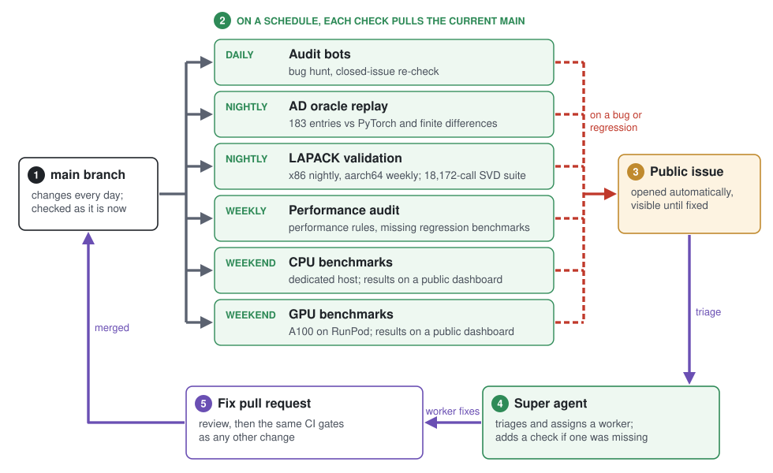
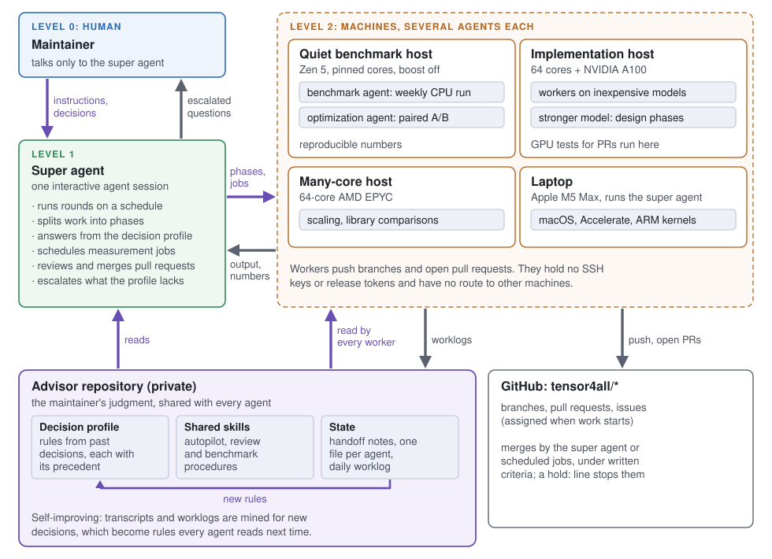
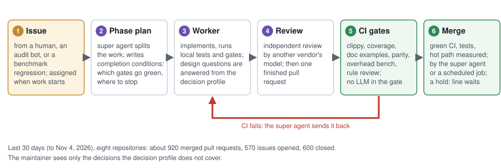

# How we check code that nobody reads line by line

*Most of the tensor4all Rust stack is written by AI agents, and we do not review it line by line. This post explains what we do instead, so that users can judge for themselves how far to trust it.*

by **Hiroshi Shinaoka** (Saitama University), for the tensor4all team

*🌐 [English](https://tensor4all.org/blog/how-we-check-agent-written-code/) · [日本語](https://tensor4all.org/blog/how-we-check-agent-written-code-ja/)*

## Why this post exists

The [tensor4all](https://tensor4all.org) stack ([tenferro-rs](https://github.com/tensor4all/tenferro-rs), [tensor4all-rs](https://github.com/tensor4all/tensor4all-rs), and the kernel crates underneath them) is large, and almost all of it was written by coding agents. A natural question from users is: if the authors do not read every line, why should I trust the results?

Our answer is that line-by-line review was never enough on its own to make numerical code trustworthy. Reviewers miss things, and they miss more as code grows. What we can do is move trust into machines that check the code every day, keep their results public, and fail loudly. Without that, we could not use agents at full strength. Agents produce code faster than any human can review it, so either the checks are automatic or the speed is wasted.

The [introducing tenferro-rs](https://tensor4all.org/blog/introducing-tenferro-rs/) post described the idea briefly. This post goes through the actual machinery, layer by layer. The scale: as of November 4, 2026, the stack is about 930,000 non-blank lines of Rust across nine repositories (tenferro-rs, tensor4all-rs, strided-rs, tcontract-rs, tlinalg-rs, cpueinsum-rs, hataori-rs, tidu-rs and computegraph-rs, tests included), plus about 36,000 lines we added to our fork of faer.

## Principle: checks that keep running

A check that ran once proves little. Code changes every day, dependencies move, and a benchmark that was fast last month says nothing about today. So the most important property of our checks is that they **run on a schedule, against the current main branch, and publish their results**: audits and oracle replays every day, CPU and GPU benchmarks every weekend.

We also keep the references in their own repositories: gradient data in [tensor-ad-oracles](https://github.com/tensor4all/tensor-ad-oracles), performance comparisons in [tenferro-benchmark](https://github.com/tensor4all/tenferro-benchmark), [tensor4all-benchmark](https://github.com/tensor4all/tensor4all-benchmark) and per-library campaigns. That keeps a change to a reference visible as a change of its own, and it lets the references be rerun against any version of the libraries.

The figure below shows the loop. The super agent and the audit bots in it are described in later sections.

## Correctness of automatic differentiation

Wrong gradients are the hardest bugs to notice: the program runs, the loss goes down, and the result is subtly off. We check gradients against a database instead of against our own reasoning.

- **tensor-ad-oracles** holds reference cases for elementwise operations, reductions, and about 40 linear algebra families (SVD, eigendecompositions, QR, LU, Cholesky, solve, pseudo-inverse, determinants, norms and more). The copy that tenferro-rs replays has 183 entries covering 174 operations.
- The reference values are generated with a pinned PyTorch version and **cross-checked against independent finite differences**. The derivation notes for each rule are cross-checked against PyTorch's own autograd formulas. Only numbers and provenance are stored; no PyTorch or JAX source is copied.
- tenferro-rs replays this database in its tests, and a **nightly job replays the full database** against the current main branch (skipped on days without a commit).
- For each operation, whether derivatives are supported is declared in a manifest, and tests assert that the manifest matches reality.

We also decided that AD rule files are verified by numerical checks, not by line coverage. Writing tests only to raise a coverage number is explicitly forbidden there.

## Correctness of linear algebra kernels

- **Parity suites.** [tlinalg](https://github.com/tensor4all/tlinalg-rs) has a native backend and a LAPACK backend with the same interface. A dedicated parity crate runs both on the same inputs, across element types and batch shapes, and compares the results.
- **LAPACK validation.** Our fork of faer, [t4a-faer](https://github.com/tensor4all/faer), runs numerical validation against LAPACK test inputs, nightly on x86 and weekly on aarch64. For SVD, for example, we adapted the test families of reference LAPACK's own SVD test drivers into an 18,172-call suite (4,543 calls for each of f32, f64, c32 and c64) with known, clustered and extreme spectra. It is also how we find what is still broken: when it reports a failure, an issue is opened and the failure stays visible until it is fixed.
- **Recording upstream bugs.** Every difference between t4a-faer and upstream faer is listed in a public ledger, `PATCHSET.md`, with its status, how it was verified ("fails before, passes after"), and, for upstream bugs, a prepared upstream report where one exists.

### An example: a panic the SVD suite caught

In late October the SVD suite reported a panic for f32 and c32. `svd` stopped with "buffer is not large enough", even though its workspace had been sized by `svd_scratch` with exactly the same arguments. The smallest failing case was an 8 by 8 rank-one matrix, computed by divide and conquer, with only `V` requested.

The fix ([tensor4all/faer#73](https://github.com/tensor4all/faer/issues/73)) corrects the workspace query itself instead of padding the buffer: it models the temporaries that each merge step keeps alive. A focused regression test fails before the fix and passes after it, 4,800 calls around the recursion boundaries pass for all four scalar types, and the full 18,172-call suite then completed without a call failure. The same run also exposed a separate f32 orthogonality problem, which was tracked on its own as [#75](https://github.com/tensor4all/faer/issues/75). The workspace bug is also present in upstream faer 0.24.4, so a self-contained report with a reproducer was prepared for upstream.

## Performance

In HPC, performance regressions are nearly as costly as wrong answers, and they are easier to miss because nothing fails. We treat them the same way.

- **Overhead gates in CI.** strided-rs, tcontract-rs, tlinalg-rs and cpueinsum-rs run a small overhead benchmark on every pull request. Per-call overhead matters for us because tensor network sweeps call the same small operation thousands of times.
- **External comparisons.** tenferro is compared with PyTorch and JAX; the kernels with OpenBLAS, MKL, Apple Accelerate, TBLIS, HPTT and upstream faer.
- **A weekly run on dedicated hardware.** Every weekend, a fixed CPU host runs the benchmark campaigns with library versions taken from shared pins. The run is executed by an agent with deliberately **no authority**: it may not merge, change pins or retry; it stops on any anomaly and records which agent and model performed the run. Results are published on public dashboards with history (for example [faer](https://tensor4all.org/faer-benchmark/) and [tenferro](https://tensor4all.org/tenferro-benchmark/)).
- **A weekly run on GPU.** tenferro's GPU benchmarks run every weekend on an NVIDIA A100 rented from RunPod, with the same publication path as the CPU results.
- **Several kinds of hardware.** Performance work is not tuned on one machine. Besides the weekly host, we use a 64-core AMD EPYC server, a 64-core server with a local A100, and Apple M5 Max laptops, so that a change that helps one microarchitecture and hurts another shows up. The super agent (below) schedules optimization and measurement jobs across these machines and collects the numbers.
- **Paired comparisons.** When a change claims a speedup, it is compared against its baseline on the same machine, with an unchanged reference row as a control for machine state. A claim without such a measurement is not accepted.

## Rules, and checks for the rules

Several collaborators, at different institutions, run their own agents on the same code. Without shared rules, each group's agents would make the same mistakes separately and settle the same questions differently.

So the rules that hold across repositories live in one public place, [tensor4all-agent-rules](https://github.com/tensor4all/tensor4all-agent-rules), for agents and human contributors alike. It covers repository structure and dependency boundaries, release safety, the performance checklist and how performance claims must be measured, documentation and test policy (for example, no doc example may be skipped), crediting third-party work, and numerical and performance rules for Rust and Julia. Each repository's `AGENTS.md` stays short and points there; repository-specific rules such as `REPOSITORY_RULES.md` and `PERFORMANCE_TIPS.md` in tenferro-rs sit on top.

The first rule is that the implementation outranks the documentation: when a document and the code disagree, the document is the defect. When an agent makes a mistake that a rule could have prevented, the rule is added, and every collaborator's agents pick it up.

Rules alone are only text, so the CI enforces what can be enforced mechanically:

- formatting, and clippy with warnings as errors, including mandatory documentation of every error and panic;
- per-file coverage thresholds;
- every documentation example compiles and runs;
- architecture checks, for example that crate dependency boundaries are not crossed;
- minimum supported Rust version, macOS and Linux, and GPU runners where relevant;
- a deterministic review step that checks a pull request against the repository rules. No LLM is involved in that gate.

## A supervising agent between the workers and the maintainer

The agents that write code do not work unsupervised. Day to day, most implementation is done by worker agents running inexpensive models. Above them sits a supervising agent, the "super agent", which plays the part a careful maintainer would:

- It splits a large task into phases, hands each phase to a worker with explicit completion conditions (which gates must be green, where to stop), and reads the result.
- When a worker asks a design question, the super agent answers from a written **decision profile** of the maintainer: rules extracted from past decisions, each tied to the precedent it came from. Questions the profile does not cover go to the human.
- The profile lives in a private advisor repository together with **shared skills** (the autopilot workflow for a phase, review and benchmark procedures) and the shared **state** (handoff notes, one file per agent, a daily worklog). The super agent and every worker read it, so the maintainer's judgment reaches agents the maintainer never talks to. It also **keeps improving**: transcripts and worklogs are mined for new decisions, which become rules with their precedent attached, and every agent picks them up on its next task. A new super agent session can take over from the state after a crash or a full context.
- Finished work is reviewed independently by a model from a **different vendor** than the one that wrote it, so the writer and the reviewer do not share the same blind spots.
- Workers can push branches and open pull requests, but they hold no SSH keys or release tokens and have no route to other machines. Merges, releases and jobs on other machines go through the super agent.
- A pull request can be put on hold with a one-line reason in its description. Scheduled jobs will not merge it while the hold is there, even if CI is green.

The super agent does not replace the mechanical checks above. It decides what to build and when to stop; whether the result is correct and fast is still decided by the oracles, the benchmarks and CI.

## Handling the volume of pull requests and issues

People often ask how a small group keeps up. In the 30 days up to November 4, 2026, eight of our repositories (tenferro-rs, tensor4all-rs, strided-rs, tcontract-rs, tlinalg-rs, cpueinsum-rs, our faer fork and tenferro-benchmark) merged about 920 pull requests, opened about 570 issues and closed about 600. What makes this manageable:

- **Issues are the unit of work.** Bugs found by humans, by the audits below, and by benchmark regressions all become issues. Large changes get an umbrella issue that is split into phases, each with its own completion conditions.
- **Ownership is visible.** When work starts on an issue, it is assigned, so external contributors can see that it is taken and nobody does the same work twice.
- **One finished pull request per phase.** A worker does not open a pull request until the phase is done, reviewed, and its gates are green locally. CI then accepts or rejects it; the super agent sends it back until CI is green.
- **Merging follows written criteria.** Green CI, tests for the change, and a measurement for anything on a hot path. Pull requests that meet them can be merged by the supervising side (the super agent or a scheduled job) without waiting for the maintainer; other people's commits are kept as merge commits. Anything that needs a human decision carries a `hold:` line and waits.
- **The maintainer decides, but rarely types.** Most questions are answered from the decision profile. What reaches the human is the small set of real decisions: design directions, priorities, and new rules.

## Auditing what is already merged

CI checks a pull request once. Code that passed last month can be wrong today because something around it changed. So we also run scheduled audits over the merged code. They are operated from a private repository, and they report through ordinary public issues:

- a daily bug hunt over tenferro-rs, strided-rs and tensor4all-rs;
- a daily check that the claims of closed issues still hold in the current code;
- a weekly performance audit against the performance rules;
- conversion of the weekly benchmark results into issues;
- a weekly check that every past performance fix has a regression benchmark, adding one when missing.

The auditors open issues, and the regression benchmark job opens pull requests. Both go through the same gates as everything else.

## What this does not guarantee

We want to be clear about the limits.

- These checks cover what we thought to check. An operation with no oracle entry, or a shape no benchmark exercises, is only as good as its unit tests.
- Oracles agree with PyTorch and with finite differences. If both are wrong in the same way, we are wrong too.
- The stack is pre-1.0, and APIs still change.

If you find a result you do not trust, please open an issue. If it reveals a gap, the fix will include a new check, not only a code change.
